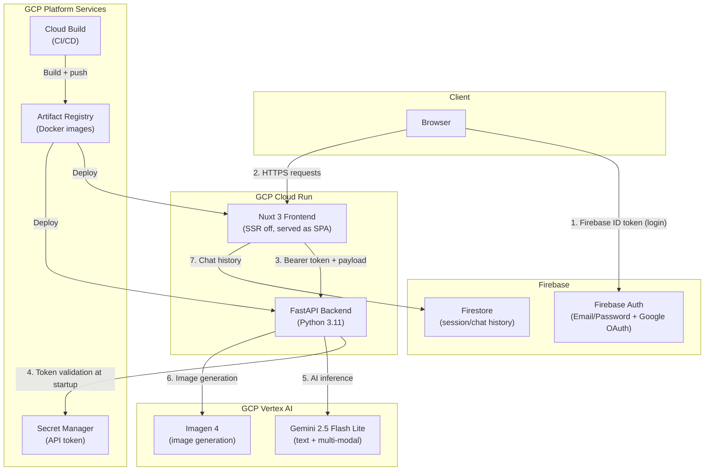

# Architecture

## System Diagram



## Component Breakdown

### Frontend (Nuxt 3)

- **SPA mode** (`ssr: false`): entire app rendered client-side, deployed to Cloud Run as a Node.js container
- **Firebase Auth**: handles login/register/OAuth; ID token stored in Pinia `auth` store
- **Pinia stores**: `auth` (user, token, roles), `roles` (admin/user permissions)
- **Composables**: `useAuth`, `useAdobeTracking` (Adobe Analytics DataLayer integration)
- **Pages**: `/ai/*` for tools, `/search/*` for internal knowledge search, `/admin/*` for user management
- **API calls**: every backend request carries a Bearer token (read from `nuxt.config.ts` runtimeConfig, injected at deploy)

### Backend (FastAPI)

- **Auth middleware**: reads API token from Secret Manager **once at startup**, validates incoming `Authorization: Bearer` headers on every protected route
- **Router per domain**: `email`, `shopping`, `images`, `social_media`, `career`, `productivity`, `llm`, `invoice_validator`
- **Service layer**: business logic lives in `services/`, routes stay thin
- **LLM module** (`modules/llm.py`): wraps `google-cloud-aiplatform`, handles `vertexai.init()`, text prediction, and multi-modal document assembly
- **Config**: `config/gcp.yml` for GCP/model settings, `config/prompt.yml` for all LLM prompt templates, `config/para.py` for hardware product code mapping (invoice tool)

### Auth Flow

```
User → Firebase (login) → ID token (browser only)
                                    ↓
Frontend → Backend Bearer token (from Secret Manager via nuxt.config runtimeConfig)
                                    ↓
Backend startup → Secret Manager → token cached in memory → validate on each request
```

The frontend Bearer token and Firebase ID token are separate concerns:
- Firebase ID token: identifies the user to Firebase/Firestore
- Backend Bearer token: a shared secret that authenticates the frontend service to the backend API (not per-user)

This is intentional — the backend is a service-to-service call, not a user-impersonation pattern. Per-user quota tracking was tracked separately in BigQuery (optional, see `gcp.yml`).

### Deployment

Both services deploy to Cloud Run via Cloud Build:

1. `git push` to main triggers Cloud Build pipeline
2. Cloud Build runs `docker build` and pushes to Artifact Registry
3. Cloud Run pulls the new image and deploys with zero-downtime traffic migration

Environment variables are injected at Cloud Run deploy time (not baked into the image). Firebase config, GCP project ID, and the API token name are all passed as `--set-env-vars` flags.

## Design Decisions

**Why not a monorepo?** Frontend and backend deploy independently on different cadences. Keeping them as separate Cloud Run services allows independent scaling (Gemini API calls can be slow; front-end assets are fast).

**Why Secret Manager for the API token instead of env vars?** Rotation without redeployment. The backend loads the token once at startup — to rotate, update the secret in Secret Manager and restart the Cloud Run instance.

**Why Pinia over Vuex?** Nuxt 3 native, better TypeScript support, simpler API. No major tradeoff for this scale.

**Why not use Firebase ID tokens for backend auth?** Would require the backend to call Firebase Admin SDK on every request. The shared Bearer token is simpler for a service-to-service pattern at this scale, and per-user auth was not needed at the backend layer.
